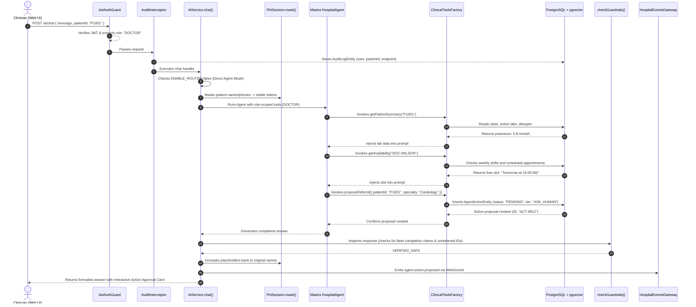

# 🏥 Complete AI Agent, System Design & Architecture Concepts Guide

> **Audience**: Software Engineers, System Architects, Product Managers, and Medical Leads.  
> **Style**: Explained Simply (Like I'm 5) + Technical Function Call Flow + Implementation Blueprint for Other Projects.

---

## 🚀 Quick Start: Commands to Run the Servers & Services

Here are the exact CLI commands to launch each tier of the medical platform:

### 1. Database & Vector Engine (PostgreSQL 16 + pgvector)
```bash
# Start PostgreSQL container with pgvector extension enabled
docker compose up -d postgres
```
*Port:* `localhost:5432` (or `5433`).

### 2. Backend API Server (NestJS 11)
```bash
# Install dependencies & run development server with hot-reload
npm install
npm run start:dev
```
*Endpoint:* `http://localhost:3000`  
*Health Check:* `GET http://localhost:3000/api/health`  
*(Auto-runs TypeORM migrations and seeds initial hospital users/patients on boot).*

### 3. Frontend Web Application (Next.js 16 + React 19)
```bash
# From repository root, navigate into the web-app directory and start dev server
cd apps/web-app
npm install
npm run dev
```
*Web Portal:* `http://localhost:3001`

### 4. Local AI & Embeddings (Ollama — Optional for 100% HIPAA On-Premise)
```bash
# Start the local Ollama daemon
ollama serve

# Pull required local LLM & embedding weights
ollama pull llama3.2
ollama pull nomic-embed-text
```

### 5. Automated Tests & Quality Benchmarks
```bash
# Run all 44 Jest test suites (606 unit & integration tests)
npm test

# Run the 149-assertion system & clinical evaluation harness against the DB
npm run test:eval
```

---

## 📑 Table of Contents

0. [Quick Start: Commands to Run the Servers & Services](#-quick-start-commands-to-run-the-servers--services)
1. [Database Architecture: Why PostgreSQL + pgvector instead of ChromaDB](#1-database-architecture-why-postgresql--pgvector-instead-of-chromadb)
2. [Core AI & Agentic Engineering Concepts (1 – 21)](#2-core-ai--agentic-engineering-concepts-1--21)
   - [1. LLM (Model, Prompting, Reasoning)](#1-llm-model-prompting-reasoning)
   - [2. Structured Output (JSON Schemas)](#2-structured-output-json-schemas)
   - [3. Tools (Function Catalog)](#3-tools-function-catalog)
   - [4. Tool Calling (Autonomous Execution Loop)](#4-tool-calling-autonomous-execution-loop)
   - [5. Memory (Short & Long-Term Persistence)](#5-memory-short--long-term-persistence)
   - [6. Context (Dynamic Assembly & State Filtering)](#6-context-dynamic-assembly--state-filtering)
   - [7. RAG (Retrieval-Augmented Generation)](#7-rag-retrieval-augmented-generation)
   - [8. MCP & External Connectors (HL7 FHIR & DICOM PACS)](#8-mcp--external-connectors-hl7-fhir--dicom-pacs)
   - [9. Workflows (Human-in-the-Loop Orchestration)](#9-workflows-human-in-the-loop-orchestration)
   - [10. Multi-Agent Architecture (Role-Specialized Personas)](#10-multi-agent-architecture-role-specialized-personas)
   - [11. Guardrails (Hallucination & False Claim Interception)](#11-guardrails-hallucination--false-claim-interception)
   - [12. Security (HIPAA PHI Shield & De-Identification)](#12-security-hipaa-phi-shield--de-identification)
   - [13. Reliability (Timeouts, Retries & Circuit Breakers)](#13-reliability-timeouts-retries--circuit-breakers)
   - [14. Evals (Automated Quality Benchmarking)](#14-evals-automated-quality-benchmarking)
   - [15. Regression (Golden Baseline Safety Gates)](#15-regression-golden-baseline-safety-gates)
   - [16. Drift Detection (Semantic & Production Shifts)](#16-drift-detection-semantic--production-shifts)
   - [17. Logging (Structured Execution Audit)](#17-logging-structured-execution-audit)
   - [18. Observability (Health Telemetry & Error Tracking)](#18-observability-health-telemetry--error-tracking)
   - [19. Tracing (Distributed UUID Spans & Waterfall Timing)](#19-tracing-distributed-uuid-spans--waterfall-timing)
   - [20. Cost Monitoring (Token Usage & Cloud Accounting)](#20-cost-monitoring-token-usage--cloud-accounting)
   - [21. Performance (p50 / p95 Latency & Throughput)](#21-performance-p50--p95-latency--throughput)
3. [Routing, Knowledge Ingestion & Security Guardrails (22 – 26)](#3-routing-knowledge-ingestion--security-guardrails-22--26)
   - [22. L1/L2 Query Router & Intent Classifier](#22-l1l2-query-router--intent-classifier)
   - [23. Indirect Prompt Injection Defense & Data Fencing](#23-indirect-prompt-injection-defense--data-fencing)
   - [24. Dynamic Context Fencing & Patient-Bound Checks](#24-dynamic-context-fencing--patient-bound-checks)
   - [25. Dynamic Knowledge Ingestion & PDF Parsing](#25-dynamic-knowledge-ingestion--pdf-parsing)
   - [26. Real-Time WebSockets (Live Hospital Event Streaming)](#26-real-time-websockets-live-hospital-event-streaming)
4. [Clinical Decision Support & Healthcare Engineering (27 – 34)](#4-clinical-decision-support--healthcare-engineering-27--34)
   - [27. NEWS2 Score & Sepsis Risk Triage](#27-news2-score--sepsis-risk-triage)
   - [28. Pharmacological Safety Gate (Allergies, DDIs, eGFR)](#28-pharmacological-safety-gate-allergies-ddis-egfr)
   - [29. Critical Panic Lab Value Surveillance](#29-critical-panic-lab-value-surveillance)
   - [30. Cross-Departmental Clinical Referrals Workflow](#30-cross-departmental-clinical-referrals-workflow)
   - [31. Specialist Availability & Appointment Scheduling](#31-specialist-availability--appointment-scheduling)
   - [32. Patient Identity Resolution & De-duplication](#32-patient-identity-resolution--de-duplication)
   - [33. 4-Tier Follow-Up Care Bundles](#33-4-tier-follow-up-care-bundles)
   - [34. Emergency Queue Monitor & SLA Escalation Daemon](#34-emergency-queue-monitor--sla-escalation-daemon)
5. [Enterprise System Design Patterns (35 – 43)](#5-enterprise-system-design-patterns-35--43)
   - [35. Clean / Layered Hexagonal Architecture](#35-clean--layered-hexagonal-architecture)
   - [36. Decoupled Post-Commit Side Effect Pattern](#36-decoupled-post-commit-side-effect-pattern)
   - [37. HIPAA Access Audit & Non-Repudiation Interceptor](#37-hipaa-access-audit--non-repudiation-interceptor)
   - [38. HIPAA Minimum Necessary Rule (Field-Level Security)](#38-hipaa-minimum-necessary-rule-field-level-security)
   - [39. Idempotent State Machine & Atomic Conditional Claims](#39-idempotent-state-machine--atomic-conditional-claims)
   - [40. Read-Back Verification Pattern](#40-read-back-verification-pattern)
   - [41. CQRS (Command Query Responsibility Segregation)](#41-cqrs-command-query-responsibility-segregation)
   - [42. Defense-in-Depth & Zero-Trust Security](#42-defense-in-depth--zero-trust-security)
   - [43. Two-Tier Caching & Cold-Start Deduplication](#43-two-tier-caching--cold-start-deduplication)
6. [The 5 SOLID Object-Oriented Principles](#6-the-5-solid-object-oriented-principles)
7. [End-to-End Execution Trace: What Happens When a Clinician Types a Message?](#7-end-to-end-execution-trace-what-happens-when-a-clinician-types-a-message)

---

## 1. Database Architecture: Why PostgreSQL + pgvector instead of ChromaDB?

### 🧒 Explain Like I'm 5 (ELI5)
Imagine you have a toy box (PostgreSQL) where you keep all your LEGO bricks, action figures, and drawing books.  
Now imagine someone tells you: *"Every time you build a LEGO car, you must put the photo of that car in a separate closet down the street (ChromaDB)!"*  
What happens when you take the LEGO car apart? You might forget to run down the street to delete the photo. Now your closet has photos of toys that don't exist anymore!  
**With PostgreSQL + `pgvector`**, your toys and your photos live in the **exact same box**. If you throw away a toy, the photo is thrown away at the exact same moment. No running down the street!

---

### 🏥 What We Implemented & Why We Avoided ChromaDB
In many AI tutorials, developers run `chromadb` as an external vector database. In production enterprise healthcare, ChromaDB causes the notorious **Dual-Database Dilemma**:

| Feature | PostgreSQL + `pgvector` (Our Solution) | Separate ChromaDB / Pinecone |
|---|---|---|
| **Data Consistency** | **Single ACID Transaction**: Patient charts and vector embeddings are saved or deleted together. | **Distributed Desynchronization**: If Chroma fails, Postgres is updated but vectors remain stale. |
| **Cascading Deletions** | `DELETE FROM patients WHERE id = $1` automatically deletes clinical vectors via foreign keys. | Requires custom microservice sync scripts; prone to orphan records. |
| **Relational SQL Filtering** | Single SQL query joins patient demographics, visit status, and cosine similarity. | Chroma cannot do SQL joins; forces pulling thousands of IDs into Node.js memory. |
| **Hybrid Search (RRF)** | Fuses native PostgreSQL full-text search (`to_tsvector`) with vector cosine (`<=>`) in one database pass. | Requires separate Elasticsearch or Meilisearch service plus ChromaDB. |
| **Infrastructure Overhead** | Single container on port `5433`. Zero extra microservices to secure, patch, or monitor. | Requires hosting, securing, backing up, and paying for an extra vector server. |
| **HIPAA Compliance** | Battle-tested PostgreSQL encryption at rest, role privileges, and automated WAL backups. | Extra attack surface and unverified enterprise compliance pipelines. |

---

### 📁 Files & Function Flow
- **Definition & Store**: [`src/ai/rag/pgvector-rag.service.ts`](file:///home/bitcot/Documents/MASTRA%20FRAMEWORK/Medical%20poc/src/ai/rag/pgvector-rag.service.ts)
  - `PgVectorStore.init()`: Executes `CREATE EXTENSION IF NOT EXISTS vector` and builds `document_embeddings` table with `vector(${dims})` column and HNSW cosine index (`document_embeddings_hnsw`).
  - `PgVectorStore.upsert(chunks)`: Performs atomic `INSERT ... ON CONFLICT (id) DO UPDATE`.
  - `PgVectorStore.searchHybrid(queryText, embedding, opts)`: Runs SQL full-text search (`ts_rank_cd`) and vector distance (`1 - (embedding <=> $1::vector)`), combining them using **Reciprocal Rank Fusion (RRF)** (`fuseRanks()`).

---

### 🛠️ How to Implement This in Any Other Project
1. Run Postgres 16 with `pgvector` in Docker:
   ```yaml
   image: pgvector/pgvector:pg16
   ports: ["5432:5432"]
   ```
2. Enable extension on startup:
   ```sql
   CREATE EXTENSION IF NOT EXISTS vector;
   ```
3. Create your embedding table with HNSW index:
   ```sql
   CREATE TABLE document_embeddings (
     id TEXT PRIMARY KEY,
     source TEXT NOT NULL,
     content TEXT NOT NULL,
     embedding vector(1536) NOT NULL
   );
   CREATE INDEX ON document_embeddings USING hnsw (embedding vector_cosine_ops);
   ```
4. Query vector distance with cosine operator (`<=>`):
   ```sql
   SELECT content, 1 - (embedding <=> $1::vector) AS similarity
   FROM document_embeddings
   ORDER BY embedding <=> $1::vector
   LIMIT 5;
   ```

---

## 2. Core AI & Agentic Engineering Concepts (1 – 21)

---

### 1. LLM (Model, Prompting, Reasoning)
- **🧒 ELI5**: The brain of the robot doctor. It reads English, thinks through medical problems, and writes answers.
- **🏥 What It Does**: Provides clinical comprehension and reasoning. Runs locally via Ollama (`llama3.2-hospital`) for 100% HIPAA on-prem privacy, with plug-and-play fallbacks to OpenAI (`gpt-4o-mini`), Gemini, or Groq.
- **📁 File & Flow**:
  - [`src/ai/llm/model.ts`](file:///home/bitcot/Documents/MASTRA%20FRAMEWORK/Medical%20poc/src/ai/llm/model.ts) -> `resolveModel(process.env)`
  - Reads `LLM_PROVIDER`; configures low temperature (`0.1`) for strict clinical determinism.
- **🛠️ Implement in Other Projects**: Use Vercel AI SDK (`ai`) to abstract models:
  ```ts
  import { createOpenAI } from '@ai-sdk/openai';
  import { ollama } from 'ollama-ai-provider';
  export function getModel() {
    return process.env.PROVIDER === 'ollama' ? ollama('llama3.2') : createOpenAI()('gpt-4o');
  }
  ```

---

### 2. Structured Output (JSON Schemas)
- **🧒 ELI5**: When you fill out a passport form with boxes for "First Name" and "Age" instead of writing a random story.
- **🏥 What It Does**: Guarantees the LLM returns strictly validated JSON conforming to TypeScript contracts, preventing UI crashes.
- **📁 File & Flow**:
  - [`src/ai/query/l2-planner.service.ts`](file:///home/bitcot/Documents/MASTRA%20FRAMEWORK/Medical%20poc/src/ai/query/l2-planner.service.ts) -> `L2PlannerService.planQuery(text)`
  - Passes Zod schema `planSchema` to `generateObject({ model, schema: planSchema, prompt })`.
- **🛠️ Implement in Other Projects**:
  ```ts
  import { generateObject } from 'ai';
  import { z } from 'zod';
  const schema = z.object({ intent: z.string(), confidence: z.number() });
  const { object } = await generateObject({ model, schema, prompt });
  ```

---

### 3. Tools (Function Catalog)
- **🧒 ELI5**: The doctor's bag containing a stethoscope, thermometer, and prescription pad.
- **🏥 What It Does**: Declares executable functions the AI can call (e.g. `getPatientSummary`, `searchPatients`, `getAvailability`, `proposeConsultation`).
- **📁 File & Flow**:
  - [`src/ai/tools/clinical-tools.factory.ts`](file:///home/bitcot/Documents/MASTRA%20FRAMEWORK/Medical%20poc/src/ai/tools/clinical-tools.factory.ts) -> `ClinicalToolsFactory.createTools(user)`
  - Uses `tool({ description, parameters: z.object({...}), execute: async (args) => ... })`.
  - Filters tools dynamically against the authenticated user's role via `TOOL_ROLES`.
- **🛠️ Implement in Other Projects**: Define functions using Zod schemas and pass them to your agent runner.

---

### 4. Tool Calling (Autonomous Execution Loop)
- **🧒 ELI5**: The doctor deciding on their own: *"First I will check your temperature, then depending on what it says, I will order a blood test."*
- **🏥 What It Does**: Autonomous loop where the agent inspects the user's prompt, decides which tool to call, receives execution data, and reasons over the result across up to 5 steps (`maxSteps: 5`).
- **📁 File & Flow**:
  - [`src/ai/agent.ts`](file:///home/bitcot/Documents/MASTRA%20FRAMEWORK/Medical%20poc/src/ai/agent.ts) -> `createHospitalAgent().generate({ prompt, tools, maxSteps: 5 })`
  - Model yields tool call -> Mastra calls `tool.execute()` -> output appends to conversation -> model writes final answer.

---

### 5. Memory (Short & Long-Term Persistence)
- **🧒 ELI5**: The doctor's notepad where they write down what you said earlier so you don't have to repeat your name and symptoms every 2 minutes.
- **🏥 What It Does**: Persists multi-turn conversations in PostgreSQL, letting users ask pronoun follow-ups like *"what were those lab values?"* or *"what about her allergies?"*.
- **📁 File & Flow**:
  - [`src/ai/memory/conversation-memory.service.ts`](file:///home/bitcot/Documents/MASTRA%20FRAMEWORK/Medical%20poc/src/ai/memory/conversation-memory.service.ts)
  - `saveMessage()`: Stores turn in `AgentMessageEntity`.
  - `getRecentMessages()`: Retrieves past turns, formatted for context sliding windows.
- **🛠️ Implement in Other Projects**: Store messages in a SQL table keyed by `threadId`, and prepend recent messages to each prompt.

---

### 6. Context (Dynamic Assembly & State Filtering)
- **🧒 ELI5**: Giving the doctor your medical folder before you walk in, with secret pages taken out if you aren't supposed to see them.
- **🏥 What It Does**: Compiles role-based prompt guidelines, active patient vitals, emergency room alerts, and system time, producing a SHA-256 state hash for audit caching.
- **📁 File & Flow**:
  - [`src/ai/context/agent-context.builder.ts`](file:///home/bitcot/Documents/MASTRA%20FRAMEWORK/Medical%20poc/src/ai/context/agent-context.builder.ts) -> `AgentContextBuilder.build(user, patientId)`

---

### 7. RAG (Retrieval-Augmented Generation)
- **🧒 ELI5**: An open-book exam. Instead of guessing from memory, the robot looks up the exact hospital rulebook in the library before answering.
- **🏥 What It Does**: Retrieves hospital clinical protocols, triage SOPs, and guidelines from PostgreSQL vector storage, injecting verified facts into the prompt.
- **📁 File & Flow**:
  - [`src/ai/rag/vector-rag.service.ts`](file:///home/bitcot/Documents/MASTRA%20FRAMEWORK/Medical%20poc/src/ai/rag/vector-rag.service.ts)
  - `indexKnowledgeBase()`: Ingests `/knowledge/*.md` files with SHA-256 deduplication.
  - `searchPolicies(question)`: Generates vector embedding via `nomic-embed-text` and executes hybrid RRF search in `PgVectorStore`.

---

### 8. MCP & External Connectors (HL7 FHIR & DICOM PACS)
- **🧒 ELI5**: A universal translator plug that lets the robot speak to the hospital's giant international computer systems and X-ray machines.
- **🏥 What It Does**: Connects the AI agent to external healthcare standards: HL7 FHIR R4 (HAPI server) and DICOM PACS (Orthanc imaging server).
- **📁 File & Flow**:
  - [`src/ai/fhir/fhir-hapi.client.ts`](file:///home/bitcot/Documents/MASTRA%20FRAMEWORK/Medical%20poc/src/ai/fhir/fhir-hapi.client.ts) -> `upsertPatient()`, `upsertObservation()`
  - [`src/ai/dicom/orthanc.client.ts`](file:///home/bitcot/Documents/MASTRA%20FRAMEWORK/Medical%20poc/src/ai/dicom/orthanc.client.ts) -> `getStudies()`, `getSeries()`

---

### 9. Workflows (Human-in-the-Loop Orchestration)
- **🧒 ELI5**: The robot doctor is not allowed to give you medicine by itself. It writes a suggestion on a clipboard, and a human real doctor must sign it before anything happens.
- **🏥 What It Does**: Implements a strict Human-in-the-Loop (HITL) state machine: Proposal -> Authorization Check -> Atomic State Claim (`PENDING` -> `EXECUTING`) -> Execution -> Read-Back Verification.
- **📁 File & Flow**:
  - [`src/ai/actions/action-executor.service.ts`](file:///home/bitcot/Documents/MASTRA%20FRAMEWORK/Medical%20poc/src/ai/actions/action-executor.service.ts) -> `approveAndExecute(actionId, approver)`

---

### 10. Multi-Agent Architecture (Role-Specialized Personas)
- **🧒 ELI5**: A hospital team with different uniforms. The front desk person cannot prescribe surgery, and the brain surgeon doesn't park your car.
- **🏥 What It Does**: Spawns 8 specialized agent personas (Doctor, Nurse, Receptionist, Radiologist, Pharmacist, Coordinator, Specialist, Admin) with dedicated prompt boundaries and restricted tool permissions.
- **📁 File & Flow**:
  - [`src/ai/agent.ts`](file:///home/bitcot/Documents/MASTRA%20FRAMEWORK/Medical%20poc/src/ai/agent.ts) -> `createHospitalAgent(user)`
  - Restricts available tools and system instructions based on `user.role`.

---

### 11. Guardrails (Hallucination & False Claim Interception)
- **🧒 ELI5**: A safety referee standing behind the robot doctor who slaps its hand if it tries to invent a fake patient name or claims it did something it didn't do.
- **🏥 What It Does**: Post-generation inspection rules checking for unretrieved patient IDs, false completion claims (`"I booked your appointment"` when no action was approved), and omitted patient rows.
- **📁 File & Flow**:
  - [`src/ai/guardrails.ts`](file:///home/bitcot/Documents/MASTRA%20FRAMEWORK/Medical%20poc/src/ai/guardrails.ts)
  - `checkGuardrails()`: Flags hallucinated IDs.
  - `reconcileActionClaims()`: Replaces false completion statements with genuine proposal statuses.

---

### 12. Security (HIPAA PHI Shield & De-Identification)
- **🧒 ELI5**: Replacing your real name, phone number, and address with secret agent codes like `[PATIENT_1]` before sending messages into the cloud, then swapping your real name back when the message returns to your screen.
- **🏥 What It Does**: Bidirectional in-memory Protected Health Information (PHI) anonymization ensuring zero patient data leaks to third-party cloud LLM providers.
- **📁 File & Flow**:
  - [`src/ai/security/phi-session.ts`](file:///home/bitcot/Documents/MASTRA%20FRAMEWORK/Medical%20poc/src/ai/security/phi-session.ts) -> `PhiSession.mask(text)` & `PhiSession.restore(text)`
  - Drops high-risk fields (`phone`, `dob`, `passwordHash`) completely before network egress.

---

### 13. Reliability (Timeouts, Retries & Circuit Breakers)
- **🧒 ELI5**: A fuse box in your house. If an electrical wire outside starts sparking, the fuse flips off instantly to protect your TV and fridge from burning out.
- **🏥 What It Does**: Prevents clinical screen freezes with configurable request timeouts (`45s`), exponential backoff retries with jitter for transient 429/500 errors, and a stateful circuit breaker.
- **📁 File & Flow**:
  - [`src/ai/reliability/resilience.ts`](file:///home/bitcot/Documents/MASTRA%20FRAMEWORK/Medical%20poc/src/ai/reliability/resilience.ts) -> `CircuitBreaker`, `withTimeout()`, `withRetry()`
  - [`src/ai/reliability/llm-runner.ts`](file:///home/bitcot/Documents/MASTRA%20FRAMEWORK/Medical%20poc/src/ai/reliability/llm-runner.ts) -> `LlmRunner.run()`

---

### 14. Evals (Automated Quality Benchmarking)
- **🧒 ELI5**: Giving the robot doctor a 1,000-question medical exam every time a programmer changes a single line of code to make sure it didn't get dumber.
- **🏥 What It Does**: Automated testing harness evaluating 149 system assertions against the real database and over 1,500 role-specific conversational scenarios.
- **📁 File & Flow**:
  - [`tests/evaluation/system/evaluator.ts`](file:///home/bitcot/Documents/MASTRA%20FRAMEWORK/Medical%20poc/tests/evaluation/system/evaluator.ts) -> `runSystemEval()`

---

### 15. Regression (Golden Baseline Safety Gates)
- **🧒 ELI5**: Taking a photograph of a clean, perfect bedroom. If any toy is dropped on the floor tomorrow, an alarm rings and stops you from leaving.
- **🏥 What It Does**: Automated diff comparator checking current test results against `baseline.json`. Exits with a non-zero code to fail CI/CD builds if any previously passing check fails.
- **📁 File & Flow**:
  - [`tests/evaluation/baseline.json`](file:///home/bitcot/Documents/MASTRA%20FRAMEWORK/Medical%20poc/tests/evaluation/baseline.json) & [`tests/evaluation/system/evaluator.ts`](file:///home/bitcot/Documents/MASTRA%20FRAMEWORK/Medical%20poc/tests/evaluation/system/evaluator.ts)

---

### 16. Drift Detection (Semantic & Production Shifts)
- **🧒 ELI5**: Checking your car's steering wheel over months to see if it slowly started pulling to the left without you noticing.
- **🏥 What It Does**: Detects subtle behavioral wanderings where model outputs drift away from medical references (`SemanticScorer`), or production error rates spike above baselines (`detectDrift`).
- **📁 File & Flow**:
  - [`tests/evaluation/agent/semantic.ts`](file:///home/bitcot/Documents/MASTRA%20FRAMEWORK/Medical%20poc/tests/evaluation/agent/semantic.ts) -> `SemanticScorer.similarity(answer, reference)`
  - [`src/ai/observability/metrics.ts`](file:///home/bitcot/Documents/MASTRA%20FRAMEWORK/Medical%20poc/src/ai/observability/metrics.ts) -> `detectDrift(current, baseline)`

---

### 17. Logging (Structured Execution Audit)
- **🧒 ELI5**: An airplane flight data recorder (black box) that writes down every button pushed and altitude change.
- **🏥 What It Does**: Persists step-level execution records in PostgreSQL (`AgentRunEntity`) with PHI-masked inputs, tool durations, and stack traces for forensic investigations.
- **📁 File & Flow**:
  - [`src/ai/observability/run-recorder.ts`](file:///home/bitcot/Documents/MASTRA%20FRAMEWORK/Medical%20poc/src/ai/observability/run-recorder.ts) -> `RunRecorder.build()`

---

### 18. Observability (Health Telemetry & Error Tracking)
- **🧒 ELI5**: The instrument dashboard in a hospital cockpit showing heart rate, battery levels, and blinking warning lights.
- **🏥 What It Does**: Computes sliding-window health telemetry: error rate (`errorRate`), guardrail warning rate, tool failure rate, and active model distributions.
- **📁 File & Flow**:
  - [`src/ai/observability/metrics.ts`](file:///home/bitcot/Documents/MASTRA%20FRAMEWORK/Medical%20poc/src/ai/observability/metrics.ts) -> `computeMetrics(rows, hours)`

---

### 19. Tracing (Distributed UUID Spans & Waterfall Timing)
- **🧒 ELI5**: A stopwatch that times every single step of making a pizza: 10s to roll dough, 5s to add sauce, 20s to bake.
- **🏥 What It Does**: Assigns a unique UUID `traceId` to every query, recording nested execution spans (`type: 'llm' | 'memory' | 'tool'`) with start offsets and millisecond durations.
- **📁 File & Flow**:
  - [`src/ai/observability/run-recorder.ts`](file:///home/bitcot/Documents/MASTRA%20FRAMEWORK/Medical%20poc/src/ai/observability/run-recorder.ts) -> `RunRecorder.step(type, name, fn)`

---

### 20. Cost Monitoring (Token Usage & Cloud Accounting)
- **🧒 ELI5**: An electric meter on your wall that counts how many units of electricity you burn each time you turn on a lightbulb.
- **🏥 What It Does**: Extracts prompt, completion, and total tokens from model responses (`usage`), calculating average tokens per query (`avgTokens`) to monitor budgets.
- **📁 File & Flow**:
  - [`src/ai/observability/run-recorder.ts`](file:///home/bitcot/Documents/MASTRA%20FRAMEWORK/Medical%20poc/src/ai/observability/run-recorder.ts) & [`src/ai/observability/metrics.ts`](file:///home/bitcot/Documents/MASTRA%20FRAMEWORK/Medical%20poc/src/ai/observability/metrics.ts)

---

### 21. Performance (p50 / p95 Latency & Throughput)
- **🧒 ELI5**: Checking how fast an ambulance arrives: 50% of the time it arrives in 4 minutes, and 95% of the time within 8 minutes.
- **🏥 What It Does**: Computes 50th and 95th percentile latency quantiles (`p50LatencyMs`, `p95LatencyMs`) to ensure emergency triage queries meet clinical response SLAs.
- **📁 File & Flow**:
  - [`src/ai/observability/metrics.ts`](file:///home/bitcot/Documents/MASTRA%20FRAMEWORK/Medical%20poc/src/ai/observability/metrics.ts) -> `pct(sorted, 0.50)`, `pct(sorted, 0.95)`

---

## 3. Routing, Knowledge Ingestion & Security Guardrails (22 – 26)

---

### 22. L1/L2 Query Router & Intent Classifier
- **🧒 ELI5**: A triage nurse at the front door. If you say *"where is the bathroom?"*, they answer in 1 second. If you have a mysterious stomach pain, they send you to a senior doctor.
- **🏥 What It Does**:
  - **L1 Parser**: Regex and vocabulary matching returning answers in `<10ms`.
  - **L2 Planner**: If confidence `< 0.70`, consults an LLM planner.
  - **Bypass Toggle**: Setting `ENABLE_ROUTER=false` in `.env` bypasses the router completely, routing all questions to the conversational AI Agent with full memory.
- **📁 File & Flow**:
  - [`src/ai/query/query-router.service.ts`](file:///home/bitcot/Documents/MASTRA%20FRAMEWORK/Medical%20poc/src/ai/query/query-router.service.ts) -> `route(message)`
  - Controlled via `ENABLE_ROUTER=false` in [`.env`](file:///home/bitcot/Documents/MASTRA%20FRAMEWORK/Medical%20poc/.env) and [`src/ai/ai.service.ts`](file:///home/bitcot/Documents/MASTRA%20FRAMEWORK/Medical%20poc/src/ai/ai.service.ts).

---

### 23. Indirect Prompt Injection Defense & Data Fencing
- **🧒 ELI5**: Putting incoming mail inside a glass box so that if someone wrote *"BURN DOWN THE HOSPITAL"* on a letter, the robot only reads it as a letter, not as an order to obey.
- **🏥 What It Does**: Encloses all retrieved patient records and notes in XML tags (`<DATA source="...">`) and neutralizes role markers (`system:`, `assistant:`, `<|...|>`) to prevent chart text from hijacking the AI.
- **📁 File & Flow**:
  - [`src/ai/data-fence.ts`](file:///home/bitcot/Documents/MASTRA%20FRAMEWORK/Medical%20poc/src/ai/data-fence.ts) -> `fenceData(label, body)`, `neutraliseInjection(text)`

---

### 24. Dynamic Context Fencing & Patient-Bound Checks
- **🧒 ELI5**: Locking the medicine cabinet for patient Bob so nobody can accidentally give Bob's medicine to Alice.
- **🏥 What It Does**: Dynamic policy withholding tools if an encounter is closed, and rejecting tool execution if the model tries to target a patient outside `ctx.allowedPatientIds`.
- **📁 File & Flow**:
  - [`src/ai/context/tool-policy.ts`](file:///home/bitcot/Documents/MASTRA%20FRAMEWORK/Medical%20poc/src/ai/context/tool-policy.ts) -> `bindingViolation()`, `withheldReason()`

---

### 25. Dynamic Knowledge Ingestion & PDF Parsing
- **🧒 ELI5**: Dropping a new textbook on the robot's desk. It instantly scans every page and can answer questions about it 2 seconds later.
- **🏥 What It Does**: Live administrative upload accepting Markdown, TXT, and binary PDFs (`pdf-parse`); extracts text, generates vector embeddings, and saves to PostgreSQL with transactional rollback.
- **📁 File & Flow**:
  - [`src/ai/rag/knowledge-documents.service.ts`](file:///home/bitcot/Documents/MASTRA%20FRAMEWORK/Medical%20poc/src/ai/rag/knowledge-documents.service.ts) -> `extractText()`, `add()`

---

### 26. Real-Time WebSockets (Live Hospital Event Streaming)
- **🧒 ELI5**: A hospital-wide walkie-talkie channel that beeps the exact instant an emergency alert or prescription approval happens.
- **🏥 What It Does**: JWT-authenticated Socket.IO gateway streaming live action proposals, approvals, NEWS2 deterioration alerts, and panic labs to role rooms without browser refreshes.
- **📁 File & Flow**:
  - [`src/events/hospital-events.gateway.ts`](file:///home/bitcot/Documents/MASTRA%20FRAMEWORK/Medical%20poc/src/events/hospital-events.gateway.ts) -> `emitActionProposed()`, `emitNews2Alert()`

---

## 4. Clinical Decision Support & Healthcare Engineering (27 – 34)

---

### 27. NEWS2 Score & Sepsis Risk Triage
- **🧒 ELI5**: A simple 0-to-20 health score. If your score jumps from 2 to 7, nurses run to your bed immediately.
- **🏥 What It Does**: Evaluates 6 vital signs (respiration rate, SpO2, supplemental oxygen, systolic BP, pulse, consciousness/AVPU, temperature) plus SIRS sepsis screen, triggering emergency escalation if score `>= 5`.
- **📁 File & Flow**:
  - [`src/hospital/news2.service.ts`](file:///home/bitcot/Documents/MASTRA%20FRAMEWORK/Medical%20poc/src/hospital/news2.service.ts) -> `News2Service.calculate(vitals)`, `News2Service.assess(vitals)`

---

### 28. Pharmacological Safety Gate (Allergies, DDIs, eGFR)
- **🧒 ELI5**: A pharmacy robot checking your chart: *"Stop! This patient is allergic to penicillin, and their kidneys cannot handle this dose!"*
- **🏥 What It Does**: Deterministic medication screening auditing allergy cross-reactivity (penicillins, cephalosporins), drug-drug interactions (Warfarin + NSAIDs), and CKD-EPI 2021 eGFR renal math (Metformin contraindication).
- **📁 File & Flow**:
  - [`src/hospital/medication-safety.service.ts`](file:///home/bitcot/Documents/MASTRA%20FRAMEWORK/Medical%20poc/src/hospital/medication-safety.service.ts) -> `audit(patient, medications, creatinine)`

---

### 29. Critical Panic Lab Value Surveillance
- **🧒 ELI5**: A fire alarm in the blood lab that rings the second a fatal potassium level or heart attack marker is found.
- **🏥 What It Does**: Screens laboratory results against critical panic ranges (e.g. Potassium < 2.5 or > 6.0 mmol/L, elevated troponin); automatically dispatches urgent tasks to attending doctors.
- **📁 File & Flow**:
  - [`src/hospital/lab-rules.ts`](file:///home/bitcot/Documents/MASTRA%20FRAMEWORK/Medical%20poc/src/hospital/lab-rules.ts) & [`src/hospital/labs/lab-orders.service.ts`](file:///home/bitcot/Documents/MASTRA%20FRAMEWORK/Medical%20poc/src/hospital/labs/lab-orders.service.ts) -> `evaluatePanicValues()`

---

### 30. Cross-Departmental Clinical Referrals Workflow
- **🧒 ELI5**: When the emergency doctor sends a digital letter to the heart surgeon saying: *"Please look at this patient today, it is an emergency!"*
- **🏥 What It Does**: Referral lifecycle state machine (`REQUESTED` -> `ACCEPTED` -> `IN_PROGRESS` -> `COMPLETED`) with urgency bands (`EMERGENCY`, `URGENT`, `ROUTINE`), automated specialist socket notifications, and visit advancement to `FOLLOW_UP`.
- **📁 File & Flow**:
  - [`src/hospital/referrals/referral.service.ts`](file:///home/bitcot/Documents/MASTRA%20FRAMEWORK/Medical%20poc/src/hospital/referrals/referral.service.ts) -> `createReferral()`, `transitionStatus()`

---

### 31. Specialist Availability & Appointment Scheduling
- **🧒 ELI5**: A smart digital calendar that knows every doctor's shift and refuses to let two patients book the same 10:00 AM slot.
- **🏥 What It Does**: Models weekly doctor shifts (`DoctorAvailabilityEntity`), calculates open appointment slots over 14-60 days, and enforces conflict guards (`assertBookable`) throwing `409 Conflict` on overlaps.
- **📁 File & Flow**:
  - [`src/hospital/specialists/specialist.service.ts`](file:///home/bitcot/Documents/MASTRA%20FRAMEWORK/Medical%20poc/src/hospital/specialists/specialist.service.ts) -> `getAvailability()`, `assertBookable()`

---

### 32. Patient Identity Resolution & De-duplication
- **🧒 ELI5**: Remembering that "Robert Smith" and "Bob Smith" who live at the same phone number are the same person so we don't make two separate folders.
- **🏥 What It Does**: Matches intake patients using Unicode `NFKD` normalized names, phone suffixes (>= 7 digits), and birth dates, presenting match candidates to receptionists before creating split records.
- **📁 File & Flow**:
  - [`src/hospital/patient-matching.ts`](file:///home/bitcot/Documents/MASTRA%20FRAMEWORK/Medical%20poc/src/hospital/patient-matching.ts) -> `scoreMatch()`, `rankMatches()`

---

### 33. 4-Tier Follow-Up Care Bundles
- **🧒 ELI5**: A hospital discharge package that automatically gives you: a doctor appointment next week, a lab test order, a reminder call from a nurse, and printout instructions for home.
- **🏥 What It Does**: Composite care plan bundling 4 coordinated actions (`APPOINTMENT`, `LAB_ORDER`, `TASK`, `PATIENT_NOTICE`), executed atomically to prevent readmission.
- **📁 File & Flow**:
  - [`src/database/entities/follow-up-plan.entity.ts`](file:///home/bitcot/Documents/MASTRA%20FRAMEWORK/Medical%20poc/src/database/entities/follow-up-plan.entity.ts) & [`src/ai/actions/action-executor.service.ts`](file:///home/bitcot/Documents/MASTRA%20FRAMEWORK/Medical%20poc/src/ai/actions/action-executor.service.ts) -> `executeFollowUp()`

---

### 34. Emergency Queue Monitor & SLA Escalation Daemon
- **🧒 ELI5**: An egg timer for the waiting room. If you sit for more than 30 minutes without a doctor seeing you, a red light flashes on the head nurse's desk.
- **🏥 What It Does**: Recurring 60s background daemon querying visits waiting past `WAIT_ALERT_MINUTES=30`, emitting `events.emitUnconsultedAlert` while marking `waitAlertedAt` to avoid alarm fatigue.
- **📁 File & Flow**:
  - [`src/hospital/queue-monitor.service.ts`](file:///home/bitcot/Documents/MASTRA%20FRAMEWORK/Medical%20poc/src/hospital/queue-monitor.service.ts) -> `QueueMonitorService.tick()`

---

## 5. Enterprise System Design Patterns (35 – 43)

---

### 35. Clean / Layered Hexagonal Architecture
- **Structure**:
  ```
  [ Controllers / WebSocket Gateway ]  <-- Presentation Layer
                 ↓
  [ AiService / Lifecycle / Referrals ] <-- Application Layer
                 ↓
  [ News2 / MedicationSafety / Policy ] <-- Pure Domain Layer
                 ↓
  [ TypeORM Entities / pgvector / FHIR ] <-- Infrastructure Layer
  ```
- **Benefit**: Domain business logic has zero framework imports, making unit tests run in milliseconds without requiring database mocks.

---

### 36. Decoupled Post-Commit Side Effect Pattern
- **🧒 ELI5**: Paying for your meal at the counter first. The cashier gives you your food, and THEN writes down the receipt in their secondary ledger. If their pen runs out of ink, they don't take your sandwich back!
- **🏥 What It Does**: Secondary side effects (FHIR external sync, vector indexing) execute strictly AFTER the database transaction commits. A network glitch in FHIR never blocks local medical charts.
- **📁 File**: [`src/hospital/post-commit.service.ts`](file:///home/bitcot/Documents/MASTRA%20FRAMEWORK/Medical%20poc/src/hospital/post-commit.service.ts) -> `PostCommitService.run()`

---

### 37. HIPAA Access Audit & Non-Repudiation Interceptor
- **🧒 ELI5**: A security camera that stamps your employee badge number every time you open a filing cabinet drawer.
- **🏥 What It Does**: Intercepts all HTTP requests via NestJS `NestInterceptor`, logging user ID, role, method, URL, and patient ID into `AuditLogEntity` for regulatory compliance.
- **📁 File**: [`src/security/audit.interceptor.ts`](file:///home/bitcot/Documents/MASTRA%20FRAMEWORK/Medical%20poc/src/security/audit.interceptor.ts) -> `AuditInterceptor.intercept()`

---

### 38. HIPAA Minimum Necessary Rule (Field-Level Security)
- **🧒 ELI5**: Only showing people what they need to see: the pharmacist sees your pills, the receptionist only sees your name and waiting room chair number.
- **🏥 What It Does**: Fine-grained section matrix (`SECTION_ACCESS`) enforced symmetrically across REST endpoints and AI prompts so receptionists cannot view diagnoses or prescriptions.
- **📁 File**: [`src/hospital/section-access.ts`](file:///home/bitcot/Documents/MASTRA%20FRAMEWORK/Medical%20poc/src/hospital/section-access.ts) -> `SECTION_ACCESS`, `mayRead(role, section)`

---

### 39. Idempotent State Machine & Atomic Conditional Claims
- **🧒 ELI5**: Two children trying to grab the last piece of cake at the exact same millisecond. Only one child gets it, and the other is told *"it's already taken"*.
- **🏥 What It Does**: Atomic conditional update `UPDATE agent_action SET status = 'EXECUTING' WHERE id = :id AND status = 'PENDING'`. Guarantees exactly-once execution even if two doctors click Approve simultaneously.
- **📁 File**: [`src/ai/actions/action-executor.service.ts`](file:///home/bitcot/Documents/MASTRA%20FRAMEWORK/Medical%20poc/src/ai/actions/action-executor.service.ts)

---

### 40. Read-Back Verification Pattern
- **🧒 ELI5**: Writing an address on an envelope, then holding it up to your eyes to read it back and double-check you didn't write the wrong street number.
- **🏥 What It Does**: Immediately after writing to the database, the service performs an independent read-back query confirming the record exists before returning a success response.
- **📁 File**: [`src/ai/actions/action-executor.service.ts`](file:///home/bitcot/Documents/MASTRA%20FRAMEWORK/Medical%20poc/src/ai/actions/action-executor.service.ts) -> `action.verification = { verified, checks }`

---

### 41. CQRS (Command Query Responsibility Segregation)
- **Read Path**: Fast, read-optimized pathways (L1 regex parser, vector RAG cosine index, cached directories) returning sub-50ms responses.
- **Write Path**: Strict Human-in-the-Loop proposal generation, RBAC checks, ACID transactions, and read-back verification.

---

### 42. Defense-in-Depth & Zero-Trust Security
- 5 distinct layers of defense:
  1. Perimeter: Global JWT bearer verification (`JwtAuthGuard`).
  2. Route Level: `@Roles(...)` metadata.
  3. Tool Level: `TOOL_ROLES` runtime filtering.
  4. Prompt Level: XML Data fencing (`data-fence.ts`).
  5. Network Egress: Bidirectional PHI masking (`phi-session.ts`).

---

### 43. Two-Tier Caching & Cold-Start Deduplication
- **SHA-256 Chunk Hashing**: VectorRagService hashes chunks to skip re-indexing unchanged Markdown policies on restarts.
- **In-Memory TTL Caching**: PhiAnonymizerService caches patient names for 30 seconds to prevent database hammering on conversational turns.

---

## 6. The 5 SOLID Object-Oriented Principles

### 1. Single Responsibility Principle (SRP)
- **Rule**: A class should have only one reason to change.
- **Example**: [`News2Service`](file:///home/bitcot/Documents/MASTRA%20FRAMEWORK/Medical%20poc/src/hospital/news2.service.ts) only calculates NEWS2 scores. It does not fetch patients from the database or send notifications.

### 2. Open/Closed Principle (OCP)
- **Rule**: Open for extension, closed for modification.
- **Example**: [`EmbeddingProvider`](file:///home/bitcot/Documents/MASTRA%20FRAMEWORK/Medical%20poc/src/ai/rag/embedding.provider.ts) can be extended to support Amazon Bedrock or Cohere without changing a single line in `VectorRagService`.

### 3. Liskov Substitution Principle (LSP)
- **Rule**: Subclasses must be substitutable for their base class without breaking the program.
- **Example**: `OpenAiEmbeddingProvider`, `OllamaEmbeddingProvider`, and `LocalHashEmbeddingProvider` all implement `embed(texts: string[]): Promise<number[][]>` identically.

### 4. Interface Segregation Principle (ISP)
- **Rule**: Clients should not be forced to depend on interfaces they do not use.
- **Example**: `SpecialistView` exposes only public directory fields (`id`, `name`, `specialty`, `isAvailable`), keeping user password hashes and permissions private.

### 5. Dependency Inversion Principle (DIP)
- **Rule**: High-level modules should depend on abstractions, not concrete implementations.
- **Example**: `VectorRagService` depends on abstract `VectorStore` and abstract `EmbeddingProvider`, injected via NestJS IoC.

---

## 7. End-to-End Execution Trace: What Happens When a Clinician Types a Message?

Here is the exact step-by-step function call waterfall when a doctor types:  
`"Patient P1001 has chest pain, check their potassium and refer to Cardiology if Dr. Wilson is available."`



---

## 🚀 Summary Checklist for Other Projects

To replicate this production-grade architecture in any other software project (Fintech, Legal, Logistics, Customer Support):
1. **Database**: Use PostgreSQL 16 + `pgvector` for unified relational + vector storage (avoid dual-database desynchronization).
2. **Deterministic Sampling**: Keep LLM temperatures low (`0.1`) for reproducible enterprise actions.
3. **HITL Workflows**: Never let agents write directly to the database. Have the agent create **proposals**, and require an authorized human to approve them.
4. **Idempotent Execution**: Use atomic SQL conditional updates (`UPDATE ... WHERE status = 'PENDING'`) to prevent double-execution.
5. **Read-Back Verification**: Always re-query the database to verify that written records exist before confirming success to users.
6. **Defense-in-Depth**: Mask sensitive PII/PHI before cloud transit, fence external text inside XML tags (`<DATA>`), and filter tool access by authenticated user role.
7. **Circuit Breakers**: Wrap external APIs in a stateful circuit breaker to fail fast and protect your system from cascading crashes.
